# German power market: merit-order price model, capture prices, PPA valuation, model validation and battery arbitrage (v0.4)

What is a MWh of wind or solar power actually worth on the German day-ahead market, and what does that mean for a power purchase agreement (PPA)? This project answers that from hourly market data for 2023 to 2025 (bidding zone DE-LU, 26,304 hours, no gaps): capture prices and capture rates, the cost of negative prices, the fair strike of a pay-as-produced PPA, the shape cost of a baseload PPA and the month-to-month risk an offtaker carries.

**Main findings**
- Solar cannibalises its own price. The solar capture rate fell from 76% (2023) to 59% (2024) and 52% (2025), while wind onshore stayed at 82-87% and wind offshore at 91-96%. Across months, each additional percentage point of solar in the load lowers the solar capture rate by about 2.1 points.
- The fair pay-as-produced strike for solar dropped from 72 EUR/MWh (2023) to 46 EUR/MWh (2024 and 2025). A solar PPA priced on 2023 data would have overpaid by about 26 EUR/MWh in the following two years.
- Negative prices matter mostly for solar: 24% of 2025 solar output fell into negative-price hours. A plant that stops producing in those hours would have raised its 2025 capture price from 46 to 65 EUR/MWh.
- Selling solar as a baseload product carries a growing shape cost: 23 EUR/MWh in 2023, 32 in 2024 and 43 in 2025 (24%, 41% and 48% of the baseload price).

**v0.2: market risk and model validation** ([full report](reports/model_validation_report.md))
- A Black-76 model for a 12-month PPA price floor (60 EUR/MWh on the monthly average price) was validated like a bank's front-office model: independent Monte Carlo replication (30 prices, all within 1.7 standard errors), analytic Greeks against finite differences (relative error 3e-8), a challenger model calibrated on daily prices and a sensitivity ladder.
- Main valuation finding: the model ignores that the floor settles on a monthly average and overstates its value by 11.7% under its own assumptions. A two-factor challenger points the same way (Black-76 32% higher), but its level/noise split is not identified from three years of spot data, so the volatility input needs market data (EEX futures or options).
- One-day VaR(99%) and ES(97.5%) of a PPA offtaker were backtested over 731 days (Kupiec, Christoffersen, Basel traffic light, ES exceedance test). Normal-EWMA and GARCH(1,1)-t models land in the red zone (19-30 exceptions against 7.3 expected), with solar exceptions almost all on weekends and holidays; historical simulation passes coverage, and conditioning it on the day type fixes the wind position but not solar.

**v0.4: merit-order dispatch model**
- A merit-order model of the German lignite, hard-coal and gas fleet, driven by monthly fuel and carbon prices from open sources (World Bank, ECB, EEX auctions), reproduces the hourly day-ahead price with a correlation of 0.71 to 0.74 (daily means 0.82 to 0.85) and a mean absolute error of 20 to 23 EUR/MWh. Two parameters are calibrated on 2023 only; 2024 and 2025 are out of sample, with errors of the same size as in the calibration year.
- The model dispatches hard coal within 7% of the observed annual output, but runs lignite 12 to 15% too much and gas 12 to 15% too little: part of the gas fleet runs for heat or system services regardless of the price, which a cost-only merit order does not see.
- What it misses is the tails: it cannot produce negative prices or scarcity spikes, and in 12 to 13% of hours its price drops to zero where actual prices fall gradually (4 to 8% of hours at or below zero). These hours are set by exports, flexibility and bidding behaviour, the next things to model.

**v0.3: battery day-ahead arbitrage**
- A 1 MW battery scheduled optimally on each day's day-ahead prices (88% round trip, 10 EUR/MWh degradation cost) earned 52, 63 and 72 thousand EUR per MW in 2023, 2024 and 2025 with 2 hours of storage, and 29 to 40 (1 hour) or 79 to 114 (4 hours) thousand EUR per MW. Revenue grew by about 40% in two years for every duration.
- The reason is wider daily spreads: the mean gap between the two most and the two least expensive hours rose from 92 to 104 and 116 EUR/MWh, and hours with negative prices from 301 to 457 and 573. Across months, each additional percentage point of solar in the load widens the spread by about 2.2 EUR/MWh. Solar cannibalises its own capture price (v0.1) but feeds storage.
- Longer storage earns more per MW but less per MWh of capacity (2025: 40 thousand EUR per MWh for 1 hour, 28 for 4 hours). A naive schedule built from yesterday's prices captures 71 to 81% of the optimal profit, so knowing the day's prices is worth about a fifth of the revenue.

## Results

Yearly capture prices (EUR/MWh) and capture rates:

| Year | Baseload | Wind onshore | Wind offshore | Solar | Hours with negative price | Solar output at negative price |
|---|---|---|---|---|---|---|
| 2023 | 95.2 | 78.6 (83%) | 86.6 (91%) | 72.2 (76%) | 3.4% | 8.3% |
| 2024 | 78.5 | 64.6 (82%) | 71.4 (91%) | 46.2 (59%) | 5.2% | 18.4% |
| 2025 | 89.3 | 77.3 (87%) | 85.5 (96%) | 46.1 (52%) | 6.5% | 24.1% |

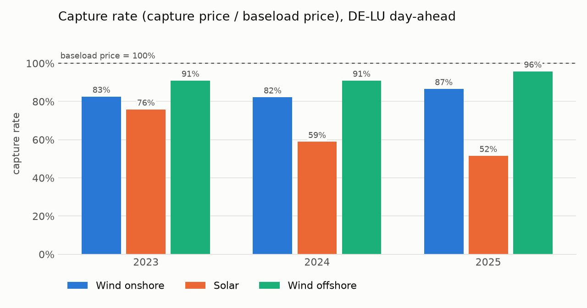

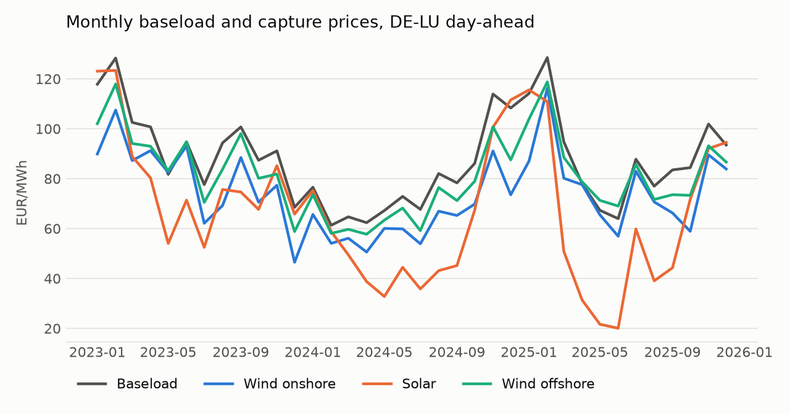

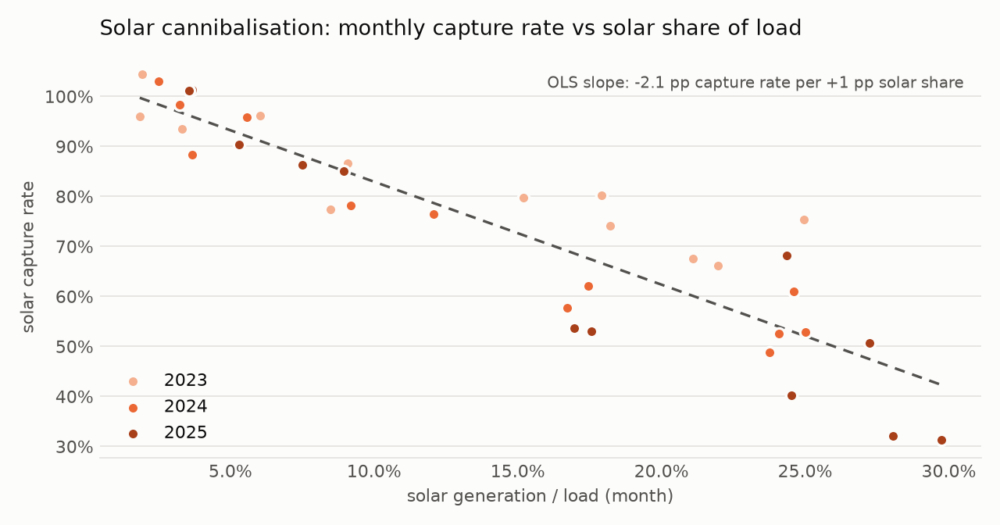

**PPA valuation.** For a pay-as-produced (PaP) PPA the fair strike over 2023-2025 equals the capture price of the period: 73.5 EUR/MWh for wind onshore, 81.0 for wind offshore and 53.6 for solar. At that strike, the offtaker's result per MWh in a single month ranges (10th to 90th percentile) from -18 to +18 EUR/MWh for onshore wind, -22 to +20 for offshore wind and -19 to +58 for solar. Solar's spread is the widest because summer months, with most of the output, are also the months with the lowest capture prices.

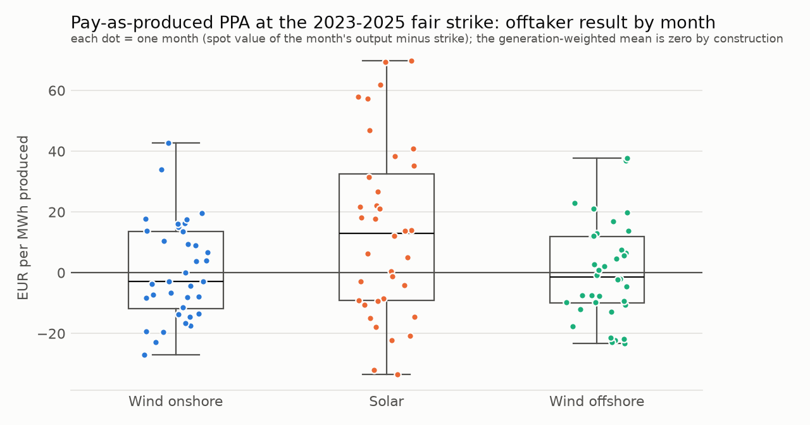

Shape cost of a baseload PPA (baseload price minus capture price, EUR/MWh):

| Year | Wind onshore | Wind offshore | Solar |
|---|---|---|---|
| 2023 | 16.6 | 8.6 | 23.0 |
| 2024 | 14.0 | 7.1 | 32.3 |
| 2025 | 12.0 | 3.8 | 43.3 |

All numbers are written by the pipeline to `results/` (`capture_prices_yearly.csv`, `capture_prices_monthly.csv`, `baseload_profile_cost.csv`, `pap_monthly_offtaker.csv`, `summary.json`).

## v0.2: model validation and market risk

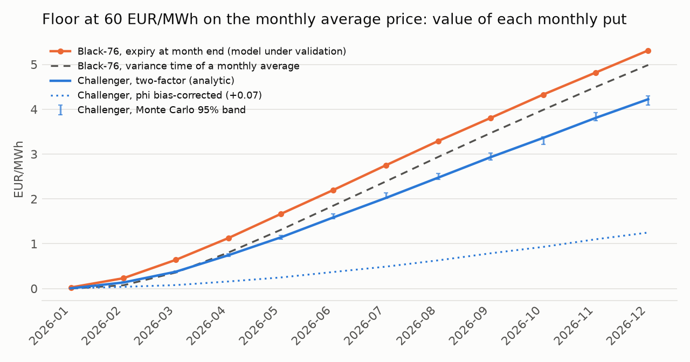

| Floor value, 12 monthly puts (EUR/MWh-month) | |
|---|---|
| Black-76, expiry at month end (model under validation) | 30.19 |
| Black-76, variance time of a monthly average | 26.66 |
| Two-factor challenger (random-walk level + mean-reverting daily deviation, arithmetic) | 22.81 |

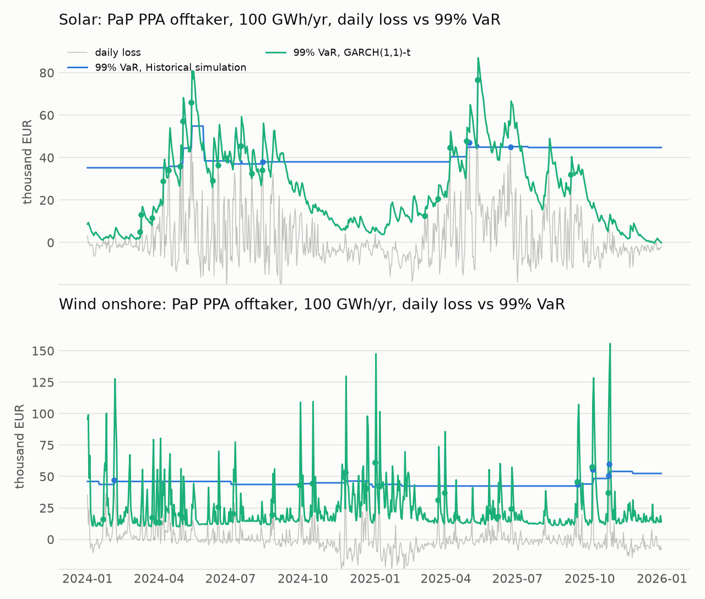

| Position | Model | Exceptions (expected 7.3) | Kupiec p | Independence p | Zone, full / worst 250 days |
|---|---|---|---|---|---|
| Solar | Historical simulation | 10 | 0.34 | 0.60 | green / yellow |
| Solar | Normal, EWMA vol | 21 | <0.001 | <0.001 | red / red |
| Solar | GARCH(1,1)-t | 19 | <0.001 | 0.51 | red / red |
| Solar | HS by day type | 14 | 0.03 | <0.001 | yellow / yellow |
| Wind onshore | Historical simulation | 10 | 0.34 | <0.001 | green / yellow |
| Wind onshore | Normal, EWMA vol | 30 | <0.001 | 0.04 | red / red |
| Wind onshore | GARCH(1,1)-t | 24 | <0.001 | 0.20 | red / red |
| Wind onshore | HS by day type | 11 | 0.20 | 0.15 | green / yellow |

Method, findings with severity and recommendations: [reports/model_validation_report.md](reports/model_validation_report.md). Outputs: `results/validation/` (replication, Greeks, sensitivity, floor strip, VaR/ES forecasts, backtests, `summary.json`).

**Methods in short.** Black-76 with analytic Greeks; antithetic Monte Carlo; implied volatility by root finding; a two-factor arithmetic price model (Schwartz-Smith type split into a random-walk level and an AR(1) deviation, weekday effects) priced in closed form (Bachelier on the monthly average) and by simulation. VaR/ES by historical simulation, normal with EWMA volatility (RiskMetrics, lambda 0.94) and GARCH(1,1) with Student-t innovations (maximum likelihood, own implementation), on a 365-day rolling window. Backtests: Kupiec proportion of failures, Christoffersen independence and conditional coverage, Basel traffic light from binomial probabilities, and a bootstrap ES exceedance test.

## v0.4: merit-order dispatch model

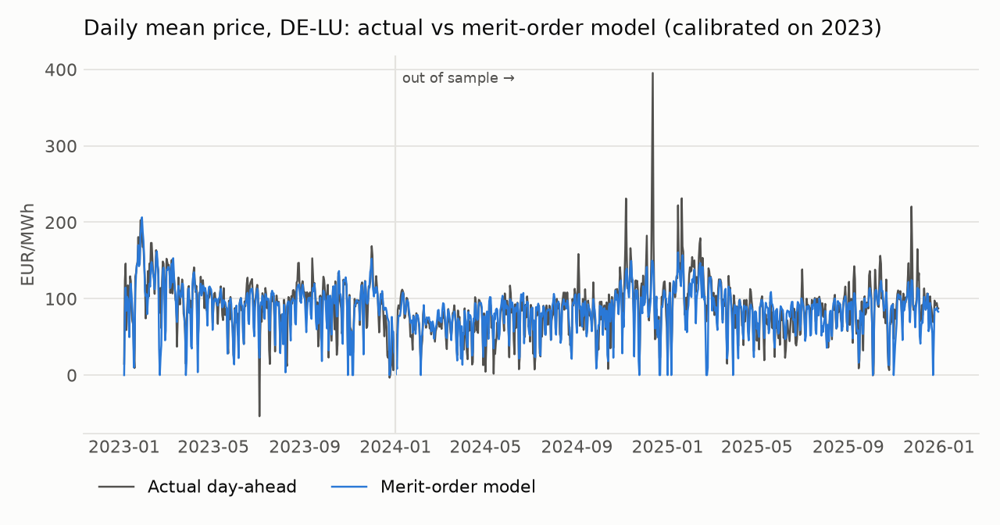

| Year | Sample | Actual mean | Model mean | MAE | RMSE | Correlation, hourly | Correlation, daily |
|---|---|---|---|---|---|---|---|
| 2023 | calibration | 95.2 | 92.9 | 20.9 | 32.3 | 0.74 | 0.85 |
| 2024 | out of sample | 78.5 | 77.4 | 20.3 | 37.3 | 0.71 | 0.82 |
| 2025 | out of sample | 89.3 | 83.7 | 22.6 | 36.2 | 0.73 | 0.83 |

Prices in EUR/MWh. Hours with prices above 200 EUR/MWh: 112, 129 and 162; hours with negative prices: 301, 457 and 573.

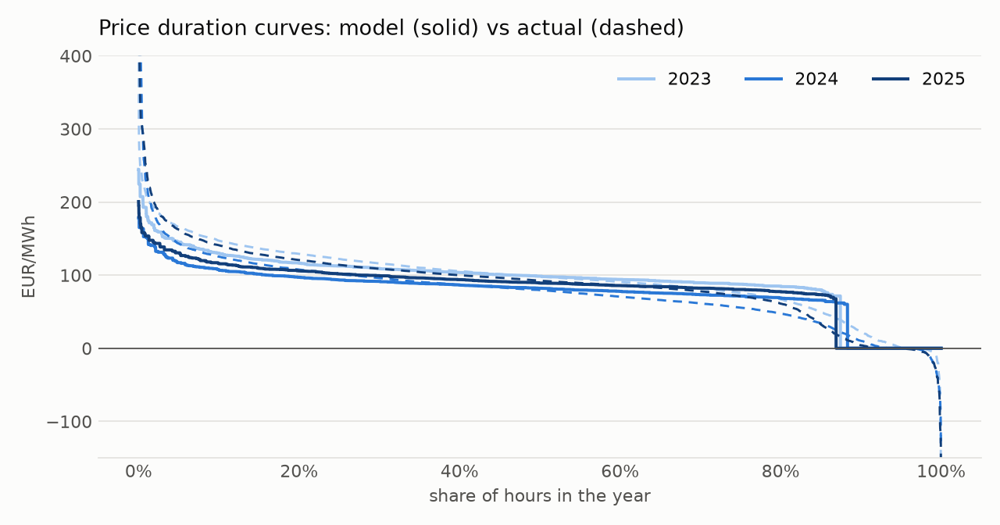

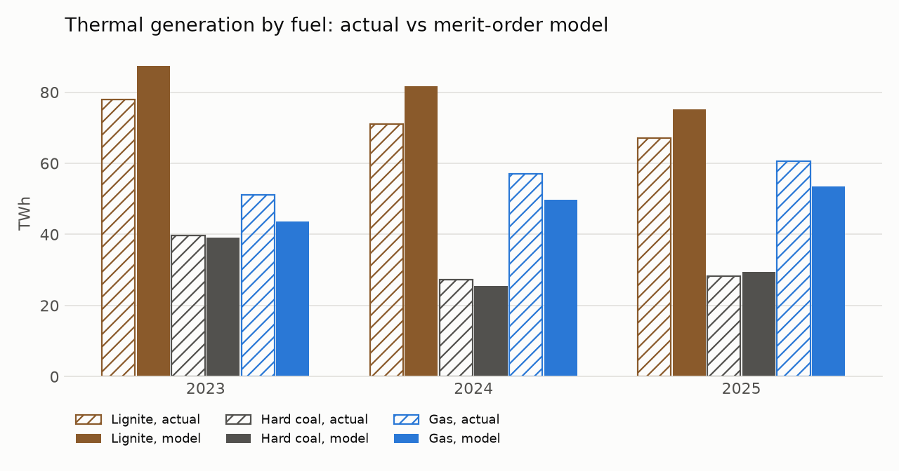

| Thermal generation, TWh (model error) | 2023 | 2024 | 2025 |
|---|---|---|---|
| Lignite, actual | 77.8 (+12%) | 71.0 (+15%) | 67.2 (+12%) |
| Hard coal, actual | 39.8 (-2%) | 27.3 (-7%) | 28.2 (+5%) |
| Gas, actual | 51.2 (-15%) | 57.0 (-13%) | 60.6 (-12%) |

**Method.** Thermal demand per hour is load plus pumped-storage consumption minus wind, solar, hydro, biomass, other renewables, other conventional, nuclear and pumped-storage generation and net imports, all from SMARD; net imports (with any statistical difference between load and generation data, 21 to 45 TWh per year) close the balance, so thermal demand equals observed lignite, hard-coal and gas output and the model decides how it is split between fuels and at what marginal cost. Per fuel and month, available capacity is the maximum observed hourly output and must-run output a quantile of it; the capacity above must-run is cut into ten blocks whose efficiency falls linearly from the best to the worst plants (lignite 43 to 31%, hard coal 46 to 34%, gas 60 to 33%). Marginal cost = (fuel price + emission factor x CO2 price) / efficiency + variable O&M (emission factors 0.364, 0.338 and 0.202 tCO2/MWh thermal; O&M 4, 4 and 2 EUR/MWh). Each hour is dispatched in merit order and the price is the cost of the last block used, which equals the dual of the demand constraint of the hourly economic-dispatch LP (checked against SciPy/HiGHS in the tests); if must-run output alone covers demand the price is zero. Calibrated on 2023 by hourly price MAE over a grid: lignite fuel cost 4 EUR/MWh thermal and must-run at the 15th percentile of monthly output (`results/dispatch/calibration_2023.csv`).

**Fuel and carbon prices** (monthly, `results/dispatch/fuel_prices_monthly.csv`): natural gas Europe (TTF) and South African coal (6000 kcal/kg, the closest open series to the API2 benchmark) from the [World Bank Commodity Price Data](https://www.worldbank.org/en/research/commodity-markets) (CC BY 4.0), converted with the ECB monthly USD/EUR reference rate ([ECB Data Portal](https://data.ecb.europa.eu/)); EU allowances as monthly means of the [EEX primary auction](https://www.eex.com/en/markets/environmental-markets/eu-ets-auctions) clearing prices. Raw files are downloaded into `data/raw/fuels/` and not committed.

**Limitations.** No negative prices and no scarcity pricing: bids below or above marginal cost, start-up costs and minimum run times are not modelled, and the zero-price step stands in for hours that exports and flexibility actually price. Imports are taken as observed rather than priced, so the model explains the domestic margin only. Fuel prices are monthly averages (daily gas price swings are averaged out), the lignite fuel cost is an assumption calibrated on 2023, and capacities and must-run are inferred from observed output rather than from plant lists. The dispatch is per hour with no ramping or storage coupling.

## v0.3: battery day-ahead arbitrage

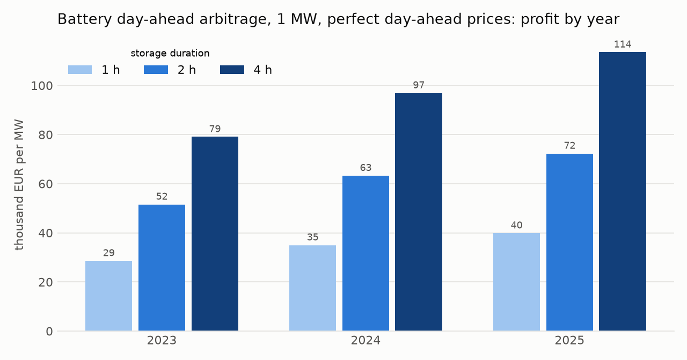

| Profit, thousand EUR per MW (cycles per year) | 2023 | 2024 | 2025 |
|---|---|---|---|
| 1 hour | 28.6 (580) | 35.0 (596) | 39.9 (582) |
| 2 hours | 51.6 (549) | 63.3 (565) | 72.3 (549) |
| 4 hours | 79.1 (434) | 96.9 (434) | 113.5 (435) |
| 2 hours, no degradation cost | 63.5 (667) | 75.6 (680) | 84.3 (670) |
| 2 hours, 20 EUR/MWh degradation cost | 41.4 (468) | 52.9 (470) | 62.1 (468) |
| Naive schedule (yesterday's prices), share of optimum, 2 hours | 73% | 76% | 81% |
| Share of charged energy bought at negative prices, 2 hours | 7% | 13% | 16% |

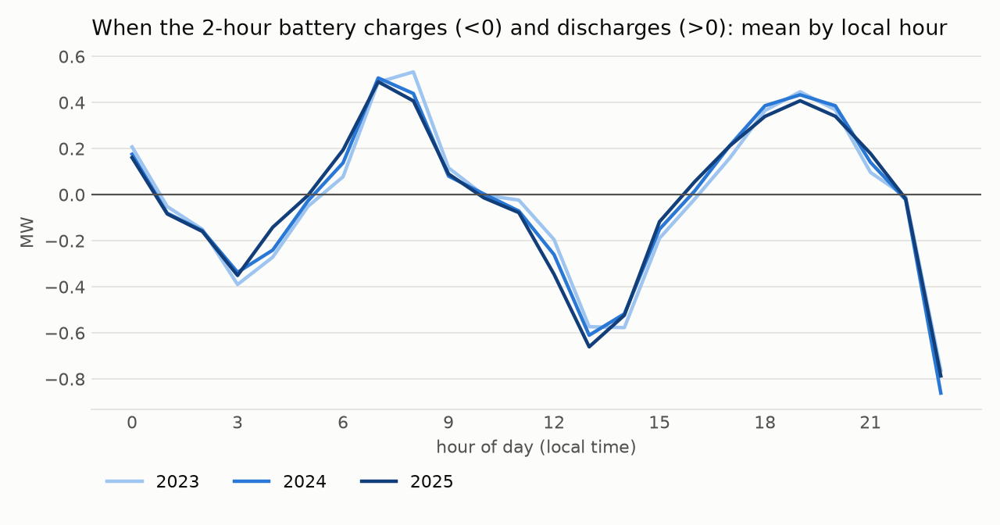

The battery cycles about 1.5 times per day: it charges at night (around 3:00) and at midday (12:00 to 14:00, the solar peak) and discharges in the morning (7:00 to 8:00) and evening (18:00 to 20:00) peaks.

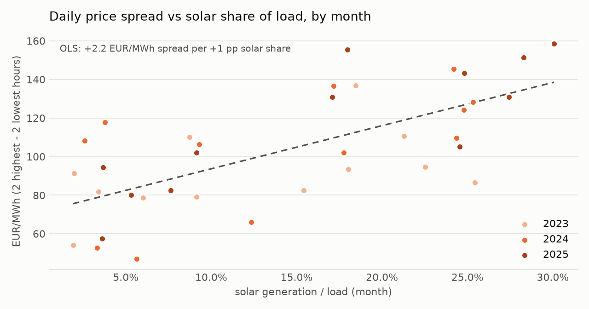

**Method.** For each local day a mixed-integer linear program (SciPy `milp`, HiGHS) chooses hourly charging and discharging (1 MW, 1, 2 or 4 MWh) to maximise revenue at that day's day-ahead prices minus a degradation cost per MWh discharged; a binary variable per hour rules out charging and discharging at the same time; the battery starts and ends each day half full. Day-ahead prices are known the day before delivery, so the schedule is achievable; the naive benchmark schedules on the previous day's prices and is settled at the actual ones. Outputs: `results/storage/` (daily results per duration, summary, degradation sensitivity, hourly profile, daily spreads, `summary.json`).

**Limitations.** Price-taker: the battery does not move prices, so the effect of a growing storage fleet on spreads (self-cannibalisation) is not modelled; historically spreads widened. Day-ahead only, no intraday, balancing or ancillary-service revenue, no grid fees or capex, so this is not a business case. The half-full constraint at midnight forces a recharge in the last hour of the day (visible at 23:00 in the profile). Hourly prices as published by SMARD, also after the switch to 15-minute day-ahead products on 1 October 2025.

## Method

- **Capture price** of a technology over a period: generation-weighted mean price, `sum(price * generation) / sum(generation)`. **Capture rate**: capture price divided by the baseload (time-weighted mean) price.
- **Curtailed capture price**: the same with negative-price hours excluded, as for a plant that stops producing when prices fall below zero.
- **Pay-as-produced PPA** at strike K: the offtaker takes every MWh at K and values it at the spot price, so its result per MWh is capture price minus K. The fair strike over a sample makes the generation-weighted result zero.
- **Baseload PPA**: the seller delivers a flat block at the baseload price and settles the difference between block and production at spot. With block volume equal to annual production, the seller's realised price is the baseload price minus the shape cost (baseload price minus capture price).
- **Cannibalisation**: ordinary least squares of the monthly solar capture rate on the monthly ratio of solar generation to load (36 months).
- Periods are calendar years and months in local time (Europe/Berlin); timestamps are stored in UTC.
- Capture prices are computed in SQL (DuckDB, `sql/capture_prices.sql`) and cross-checked in pandas in the tests.

## Data

Hourly series from [SMARD](https://www.smard.de/) (Bundesnetzagentur), licence CC BY 4.0, source: Bundesnetzagentur | SMARD.de:

| Series | SMARD filter | Unit |
|---|---|---|
| Day-ahead price, DE-LU | 4169 | EUR/MWh |
| Generation wind onshore | 4067 | MWh |
| Generation wind offshore | 1225 | MWh |
| Generation solar | 4068 | MWh |
| Grid load | 410 | MWh |

The raw weekly files are cached in `data/raw/` (not committed); the hourly table is stored in `data/market.duckdb`.

## Run

```bash
python -m venv .venv
.venv/Scripts/activate            # Windows; on Linux/macOS: source .venv/bin/activate
pip install -e ".[test]"
python -m deppa.run               # downloads 2023-2025 (cached), writes results/ and figures/
python -m deppa.validate          # v0.2: floor valuation checks and VaR/ES backtests, writes results/validation/
python -m deppa.storage_run       # v0.3: battery arbitrage 2023-2025 (about 8 minutes), writes results/storage/
python -m deppa.dispatch_run      # v0.4: merit-order price model, calibrated on 2023, writes results/dispatch/
pytest                            # offline tests on synthetic data
```

## Limitations

- Generation profiles are national fleet totals, not a single plant. A specific site has its own profile and therefore its own capture price.
- Volume risk is not assessed: national generation grows with installed capacity, so year-to-year volume changes in this data mix weather and new build. This needs capacity data (planned for a later version).
- From 1 October 2025 the day-ahead market clears in 15-minute periods; the hourly price series is used as published by SMARD.
- Historical analysis only: no forecast of future capture prices, and no imbalance costs, grid fees or guarantees of origin in the PPA values.

## Roadmap

- **v0.5**: price the margin better: an import supply curve from neighbouring zones, must-run bids below cost, daily gas prices and a unit-commitment variant (MILP with start-up costs and minimum load) for the low-price and scarcity hours.
- **v0.6**: scenarios (CO2 price, gas price shock, renewable share, coal exit) and capture prices and battery revenues under each scenario.
- Battery follow-ups: scheduling under price uncertainty (stochastic programming, value of the stochastic solution and of perfect information), intraday revenue, capex and payback.
- Validation follow-ups: volatility from EEX futures, seasonal filtered historical simulation for solar, stressed VaR.
